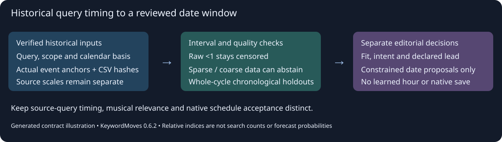

# Event-aligned keyword timing

KeywordMoves 0.6.2 `google-trends plan-event-cycles` is an offline analysis of explicit, source-hashed historical CSVs. It reuses the existing native parser, aligns bins with verified event dates, and keeps query intent, data quality and publishing judgement separate. It collects nothing, runs no model, spends no credits and makes no native copy or schedule change.



*Generated contract illustration. The executable example below runs real analysis with explicitly synthetic values; it is not Google data or a campaign result. A native-interface screenshot/video would not demonstrate this offline contract. Capture actual public-safe sources and native schedule readback separately for an authorised real application.*

## Run the reproducible example

```powershell
python examples/event_cycles.py --output event-example-output
keywordmoves run google-trends --operation plan-event-cycles --input event-example-output/manifest.json --input event-example-output/source-2023.csv --input event-example-output/source-2024.csv --input event-example-output/source-2025.csv
```

The CLI prints JSON; preserve its complete output through your normal UTF-8 file route. No inline keyword seeds or options are accepted. Python callers use `PluginRequest("plan-event-cycles", inputs=(manifest_path, *csv_paths))` through the registered `google-trends` plugin and retain `PluginResult.to_dict()`. The manifest and CSV inputs, not filenames or old notes, own the binding. Never run this operation to obtain missing data or bypass native access.

## Manifest `keywordmoves-event-cycle-plan/v1`

Required fields:

| Field | Contract |
| --- | --- |
| `subject` | Explicit song, campaign or research subject; not permission to change it. |
| `planned_at` | ISO date or aware timestamp of this analysis decision. Source observations cannot postdate it. |
| `event` | `{name,next_date,reference}`. `next_date` is a verified future ISO calendar date; `reference` supports its authority. Movable dates are supplied per cycle rather than guessed from year offsets. |
| `scope` | Exactly `{geography,search_property,category,query_kind,temporal_basis}`; property is `web` or `youtube`, kind `search_term` or `topic`. Retain actual native filter/type evidence. Calendar/UTC/local basis is explicit and must match across sources. CSV labels alone do not establish these facts. |
| `window` | `[first_relative_day,last_relative_day]`, bounded -366..366 and including event day 0. Wider original exports are accepted; the selected window must be fully covered by eligible bins in each usable cycle. |
| `sources` | 1–60 explicit source records, described below. |
| `reviews` | At most 100 explicit phrase reviews, described below. Unreviewed phrases receive no schedule proposal. |

Each source has `id`, `input_index`, `sha256`, `observed_at`, `event_date`, `event_reference`, `scope`, `source_kind`, `reference`. `input_index=1` addresses the first CSV after the manifest. `sha256` binds the exact original supplied bytes, including a BOM if present. Scope must match the manifest exactly. Source kind is `native_csv`, `native_table_transcription` or `synthetic`; record conversions honestly and retain originals. `reference` links its original capture/export, while `event_reference` supports the actual anchor date. Optional `queries` chooses a declared subset of the CSV's cleaned column names, case-insensitively, without changing its original scale/hash. Every explicit CSV input must be addressed. A multi-year CSV may be bound to distinct non-overlapping event anchors; a repeated input/event pair is rejected.

Bounds remain the existing 5 MB per CSV, 30 MB combined unique input bytes, 50,000 parsed bins and 100 phrases. Dates/columns must be unique and chronological. Malformed, hash-swapped or scope-conflicting inputs fail instead of being quietly combined. A valid header-only export remains `empty_unavailable`, never zero demand.

Each review has `phrase`, `fit=direct|context|reject`, `intent=listening|navigation|information|mixed|unvalidated`, and a specific `rationale`. Optional `preferred_sources={"YYYY-MM-DD":"SOURCE_ID"}` selects one supplied capture for a phrase/event. Separate requests for one event never count as separate cycles. If two eligible captures remain for the same phrase/event without an explicit preference, that event is held; no source is silently chosen because its peak looks more impressive. An adequately resolved standalone query can be chosen over an unusably coarse shared comparison without implying higher demand. Reject misleading meanings and unrelated trends even if their data are plentiful.

## Source quality before forecasts

The result retains raw cells and distinct numeric displays, `<1` censors, missing cells, source-partial flags and incomplete/current bins. `<1` has `value=null`, `censored=true` and displayed-index bounds `[0,1)`. It is never converted to numeric 0 or a search count. Numeric0 stays a threshold-zero display, not proof of no searches. The existing completed-bin rule excludes source-partial bins and bins ending on/after the supplied observation date. Monthly/weekly periods retain their complete intervals; a week containing the event is not assigned an invented daily peak.

Conservative fixed analysis heuristics are exposed in `metadata.policy`, not presented as Google rules or proven optima:

- At least 4 exact positive eligible bins per usable cycle. Isolated one-to-three nonzero cells abstain.
- Original displayed peak at least 10. A query suppressed to 0..3 by a much larger comparison term needs better resolved standalone evidence; rescaling it to 100 cannot recover lost information.
- Complete selected calendar-window coverage, with no explicit missing values. Censored low cells can remain when adequately resolved positive bins support the peak.
- A tied/flat peak envelope wider than 14 days abstains. Ties within that bound remain intervals.
- High-interest intervals use 75% of each cycle's original displayed peak. This is an explicit descriptive heuristic, not a volume threshold or an optimal campaign window.

Each source cycle exposes eligible/quality issues, exact positive/threshold-zero/censored/missing/excluded bin counts, covered/required days, original peak, bin precision and complete peak/high-interest intervals. All-zero/censored, sparse, coarse or incomplete inputs remain visible with the reason for abstention. No comparison rescales amplitudes across independent requests. Unknown availability is never interpreted as lack of audience interest.

## Forecast and chronological holdouts

Timing cohorts use the same query and scope and at most one selected source per distinct event date. Overlapping calendar windows are not independent cycles and are excluded with a selection issue. At least two usable events are needed for a forecast; two remain `limited_two_cycles`, without a pretend backtest. The peak forecast is the observed range of peak-bin positions across the selected past events, bounded by the14-day rule. It is an empirical timing envelope, **not a statistical confidence interval**. Majority high-interest intervals retain days supported by strictly more than half the selected cycles; no gap is silently labelled high interest.

With three or more usable events, each next whole cycle is held out chronologically, training only on earlier events (first training cohort has two). Receipts retain training/held-out event dates, predicted envelope, actual tied peak-bin intervals, overlap hit and nearest calendar distance. They do not mix future-cycle points into training. A missed held-out peak yields `unstable_held_out_timing` and no schedule proposal. Hit counts and small samples are not calibrated success probabilities. These are retrospective checks of the retained sampled data, not proof of what was available to a real-time forecaster at the time, and not causal campaign evidence.

Every candidate keeps `score=null`. `metadata.event_profile` separates analyst review, all source cycles, `independent_usable_events`, `source_selection_issues`, `forecast`, `timing_support`, `whole_cycle_chronological_holdouts`, `holdout_hits`, `holdout_predictions`, calendar `forecast_dates` / `high_interest_forecast_dates`, and an optional schedule proposal. `music_demand_validated=false`, `absolute_monthly_searches=null` and `cross_request_amplitude_comparison=false` remain explicit. A Budget/news shopping spike can inform event context without validating demand for a song or hashtag.

## Optional date-window proposals

Optional `scheduling` requires `{platform,timezone,lead_days,not_before,not_after,blocked_dates}`. Lead is an explicit editorial integer 0–90, not something learned from a daily search graph. The supplied ordered date constraints span at most732 days; blocked dates are explicit ISO dates. The operation translates the historical peak envelope to the next verified event, subtracts the declared lead, and keeps only unblocked allowed dates strictly after the analysis date. No available date gives `held_no_available_future_date`; it does not move outside the evidence window to invent an answer. Rejected/unvalidated-intent phrases and unstable/insufficient timing receive no proposal.

The proposal records target platform/timezone, dates, declared lead and `optimal_hour=null`. Target platform is an editorial destination; it does not transfer Web Search demand to YouTube/Instagram or attribute post performance to a term. A daily or weekly source cannot identify a best posting hour. Native audience activity, actual lead/processing/release constraints, account state, cross-campaign conflicts, existing approved slots, rights and destination policy remain separate evidence and judgement.

No native slot is saved or changed. A city/timezone label alone does not prove the native scheduler's future UTC instant, especially across daylight-saving changes. Independently round-trip the actual native date/time/offset to the intended named timezone/UTC and retain the persisted item readback through the owning workflow. Keep uploaded, scheduled, public, playable and verified states distinct. `implementation_authorised=false` remains explicit.

## Primary references and limits

Google's [normalisation, thresholds, sampling and noise guidance](https://support.google.com/trends/answer/4365533) and [comparison guide](https://support.google.com/trends/answer/4359550) explain the source's relative measurements. Verify the actual current source/filters and temporal basis for every application. The operation does not fetch these pages, event calendars, private APIs, owned analytics or CSVs. Source assertions require independent retained evidence. Use real separate property exports and precise native units rather than treating one search source as a universal platform score.
