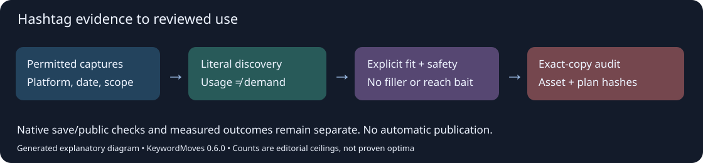
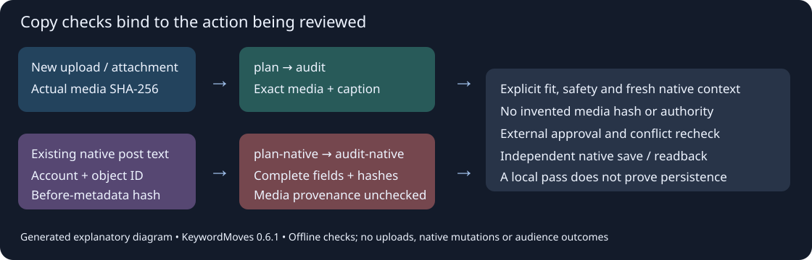

# Hashtag discovery, review and final-copy audit

KeywordMoves 0.6.0 adds the offline `hashtag-planner` workbench. It composes with existing Instagram, TikTok, YouTube, observed-evidence, monitoring and candidate-focus routes. It performs no collection, publishing, paid requests, model calls or register writes.



*Generated explanatory diagram. The reproducible example below executes the real workbench using explicitly synthetic captions; it does not show audience results.*

## Run the working example

```powershell
python examples/hashtag_planner.py --output example-output
keywordmoves run hashtag-planner --operation profiles
keywordmoves run hashtag-planner --operation discover --input capture.json
keywordmoves run hashtag-planner --operation plan --input pool.json --input review.json
keywordmoves run hashtag-planner --operation audit --input plan.json --input final-copy.json
```

The CLI writes JSON to stdout; save those exact bytes before calculating a review's `source_sha256` or final copy's `plan_sha256`. The example saves and hashes each document automatically. `audit` returns `metadata.passed`; consumers MUST inspect it: a successfully executed CLI command can return a failed audit. No options or inline keyword seeds are accepted.

## Capture contract

`keywordmoves-hashtag-capture/v1` requires `subject`, a profile's lowercase `platform`, `captured_at` (ISO date or aware timestamp), `source`, `source_kind`, `geography`, `window`, and `records`. Supply `source_kind=public_sample`, `owned_copy` or `local_proposal` accurately. Records have exactly `id`, `text`, `reference`. Retain only permitted copy, not cookies, account dumps or private correspondence. Zero records is valid; limits are 5000 records and 100000 characters per record, within the existing 20 MB JSON bound.

`discover` extracts literal hashtags using the existing YouTube span parser, excludes URL fragments/embedded identifiers/headings, normalizes NFC and case-insensitive identity, and preserves first source spelling. A repeated hashtag counts once per record; duplicate record IDs fail. Numeric-leading mixed tags such as `#3DT` are supported. Numbers-only tags, spaces and punctuation are not portable candidates. The conservative parser is not a claim that every platform accepts identical Unicode syntax; verify actual composer output. No search phrase is silently compressed or converted into a hashtag.

Each output candidate retains references, source/window, observed time and captured-record count. Local-proposal counts are labelled as such. Sample supply, query demand, estimates, trend indices and whole-post outcomes are distinct. The tool never computes a universal hashtag score.

## Review contract

`keywordmoves-hashtag-review/v1` requires exact `subject`, `platform`, `reviewed_at`, `planned_for`, `asset_sha256`, `source_sha256`, `native_check` and `decisions`. `native_check` contains `state=checked|unavailable`, `checked_at`, `reference`, `notes`. These are caller assertions requiring external evidence; this offline program cannot verify them. Optional `native_topic` is a single reviewed Threads topic string, or null.

The first input is a saved PluginResult candidate pool with `metadata.target_subject` and `metadata.target_platform`. Every phrase must include its literal `#`. Existing provider results need an explicit, reviewed target mapping before composition; that mapping never transfers demand between platforms. Candidate-level conflicting scopes fail. Preserve original provider evidence when preparing the pool, and merge duplicate normalized tags explicitly.

Each decision has exactly `phrase`, `fit=direct|adjacent|reject`, `role=brand|niche|topic|format|trend`, `safety=clear|hold|reject`, integer `priority` (1-5000) and `rationale`. Direct fit and clear safety are required. Unreviewed, rejected and adjacent tags remain out; no tag is added to fill a quota. Caller editorial priority determines order, never popularity or a provider score. At most one brand/format/trend and two niche/topic tags are selected. Roles are optional, not required slots. Generic reach bait (`#FYP`, `#Viral` etc.) is rejected.

A review expires after 14 days before planned use; non-proposal discovery evidence after 30 days. Native checks need refresh within seven days. A trend also needs a dated non-null `native_trend_rank`, `native_trend_index` or `relative_interest` observation within seven days; sample counts alone never qualify. Local proposals cannot qualify as trends. These are conservative project freshness rules, not platform policies. Source/geography/window truth remains the analyst's responsibility.

## Platform profiles

| Destination | Editorial ceiling | Intended surface |
| --- | ---: | --- |
| YouTube | 3 | Description hashtags; video tags and search phrases stay separate |
| TikTok / Instagram | 5 | Caption, after natural descriptive copy |
| Facebook / X / Bluesky | 2 | Caption/post |
| Mastodon / LinkedIn | 3 | Post, with appropriate community/professional context |
| Threads | 0 | One separately reviewed native topic, optional |
| Pinterest | 0 | Descriptive title, description, available native topics |
| Reddit | 0 | Community rules, natural title/body, allowed flair |
| WordPress | 0 | Natural copy, intentional taxonomy; no hash block |
| Spotify / Amazon Music / Apple Music | 0 | Supported native metadata, no invented hashtag field |
| Bandcamp / SoundCloud | 0 | Separately reviewed native tags, no copied hash block |

**These are editorial experiment ceilings, not platform maximums, mandatory counts or proven optimal sets. Zero is valid everywhere.** Recheck native rules and actual account/composer controls before use. The Instagram primary help route required login during this review; five is retained as our conservative ceiling without claiming verified enforcement. X's official help recommends at most two. YouTube ignores all hashtags above 60, a policy threshold unrelated to our much smaller ceiling. Native-topic selection/persistence needs its own check; this workbench does not implement the platform composer.

## Final-copy contract

`keywordmoves-hashtag-final-copy/v1` requires `subject`, `platform`, exact `asset_sha256`, exact saved `plan_sha256`, `checked_at`, `caption` and `native_topic` (null outside Threads). This binds the check to the asset and the reviewed plan. `audit` flags unexpected/missing or duplicate tags, ceiling excess, changed topic and expired/unavailable native checks. Hash/scope/asset changes fail. The audit receipt retains exact caption/final-copy/asset/plan hashes, platform/subject and check/review/native timestamps so a downstream preflight can bind it to its actual attachment bytes. It does not validate total caption length, links, claims, rights, destination accounts, rendered readability or native save/publication. Check those through the owning workflow and independently read back persisted copy.

## Learning from use

### Text-only edits to an existing native post (0.6.1)

Use the separate `plan-native` / `audit-native` contract when an existing native object is independently identified and the authorised action changes only its human-readable text. An original upload file may be unavailable. Do not invent its hash, use a video ID as a media hash, or claim the asset-bound `audit` passed. Native metadata audits never establish original master/clock mapping, media eligibility, ownership, replacement permission or publication. Those duties stay with their owning workflows.



*Generated contract illustration, not a native interface capture. Both runnable examples execute real offline checks with explicitly synthetic evidence; no video demonstration or audience screenshot would prove native persistence or media provenance.*

```powershell
python examples/native_metadata_audit.py --output native-example-output
keywordmoves run hashtag-planner --operation plan-native --input pool.json --input native-review.json --input before.json
keywordmoves run hashtag-planner --operation audit-native --input native-plan.json --input before.json --input native-final-copy.json
```

1. Save a complete permitted native text snapshot as `keywordmoves-native-metadata/v1`: `subject`, lowercase `platform`, exact `account_id`, exact `object_id`, `captured_at`, `fields`, and `native_topic` (null outside Threads). `fields` is a non-empty object of text-valued `title`, `description`, `caption` and/or `post` keys. Capture complete field contents from the editor or supported API: a truncated list preview is insufficient. Every supplied field allows at most 100,000 characters. Video tags, mentions/settings objects, media, visibility and schedule controls are outside this contract.
2. Use `keywordmoves-hashtag-native-review/v1` with the same fields and decisions as the asset review, replacing `asset_sha256` with `native_target={"account_id":"EXACT_ACCOUNT","object_id":"EXACT_OBJECT","before_metadata_sha256":"SHA256_OF_BEFORE_JSON_BYTES"}`. Account/object identifiers are opaque and exact; normalization or surrounding space is rejected. `plan-native` takes pool, review, then baseline. It applies the existing source hashes, direct-fit/safety/role/trend selection and native-context freshness checks. Baselines also require refresh within seven days under this conservative project rule. Caller identity and context assertions still require independent evidence.
3. Save `keywordmoves-hashtag-native-final-copy/v1` containing `subject`, `platform`, the identical `native_target`, exact saved `plan_sha256`, `checked_at`, complete `fields`, and `native_topic`. Supply exactly the baseline's field names, including unchanged ones. `audit-native` takes plan, baseline, final copy; it rejects account/object/scope/baseline/plan swaps and audits hashtags across **all** fields, including unexpected or repeated tags in the title. No tag can be hidden in an earlier field. Zero tags remains valid; Threads topics remain separate.

Inspect `metadata.passed`. The receipt has schema `keywordmoves-hashtag-native-audit/v1`, `target_kind=existing_native_metadata`, the exact native target, baseline capture/hash, canonical `before_fields_sha256` / `fields_sha256`, per-field UTF-8 `field_sha256`, final-document/plan hashes, selected/actual tags and relevant check dates. Field-object hashes use sorted compact JSON, UTF-8, literal Unicode and no ASCII escaping (the shared `monitoring.validation.digest` function). `media_provenance_checked=false` and `implementation_authorised=false` are explicit; `asset_sha256` is absent. Existing new-upload consumers must continue accepting only their asset-bound receipt, never this schema.

Immediately before an authorised native edit, independently re-read the same account/object and compare complete text with the baseline. Stop on a conflicting change and prepare a fresh review. After saving, independently reload the same object, preserve the complete actual accepted fields and audit that readback against the reviewed plan/baseline. A clean local audit is a supplied-copy result, not a receipt from the platform. Preserve media, visibility, rights, native tags and approved date/time/timezone through separate comparisons. Missing master-clock provenance can remain a precise media hold while a truthful, unrelated text repair proceeds under its own authority.

Record proposed, reviewed, scheduled, published and independently verified states separately. Join actual persisted tags to the exact asset hash/post ID, native account/format, source evidence and next review window. Compare like-for-like content at the same age; retain views/reach denominators, retention, search referrals, saves, meaningful replies, follows and landing-page outcomes when actually available. Whole-post success cannot be assigned to each tag. A small uncontrolled comparison is descriptive, not a causal lift claim.

## Primary references and access limits

Reviewed 23 October 2026: [YouTube hashtags](https://support.google.com/youtube/answer/6390658), [YouTube video tags](https://support.google.com/youtube/answer/146402), [TikTok Trends](https://ads.tiktok.com/resources/help/article/how-to-use-trends?lang=en-GB), [TikTok Creator Search Insights](https://newsroom.tiktok.com/creator-search-insights?lang=en), [X hashtag guidance](https://help.x.com/en/using-x/how-to-use-hashtags), [Threads native topics](https://about.fb.com/ja/news/2023/12/threadskeywordsearch_tags/), [Pinterest search setup](https://business.pinterest.com/en-in/blog/how-to-build-audience-pinterest/), [Bluesky search](https://bsky.social/about/blog/05-31-2024-search), [Mastodon posting](https://docs.joinmastodon.org/user/posting/), [LinkedIn search](https://www.linkedin.com/help/linkedin/answer/a521824), [Facebook Reels hashtags](https://www.facebook.com/help/www/2862139500770200). These describe mechanics, not evidence that any candidate is popular or that our campaign improved.

## Potential problems

- A copied set crosses platforms: reject conflicting pool/review scope; research the intended platform independently.
- A scheduled date outlives evidence: retain the plan and refresh review/native evidence before commitment; do not silently redate it.
- Unavailable native search: retain truthful local proposals; `needs_native_recheck` blocks a passing audit. Unavailable is not banned or zero demand.
- A plain keyword or differently composed asset is supplied: literal-tag and exact hash gates fail before selection/audit.
- Trending is inferred from one popular post: sample occurrence counts do not satisfy the trend evidence gate. Verify actual platform/region/window and reject unrelated events.
- This is an offline workbench: browser/native/API availability remains separate. No additional screenshot/video adds evidence of audience performance; the working example and labelled diagram demonstrate the command contract.
